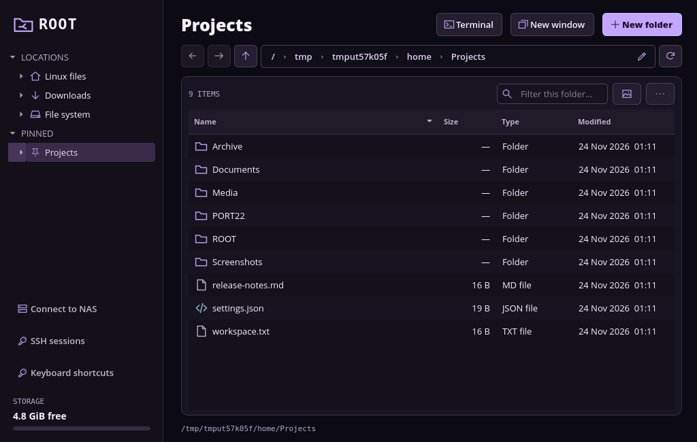
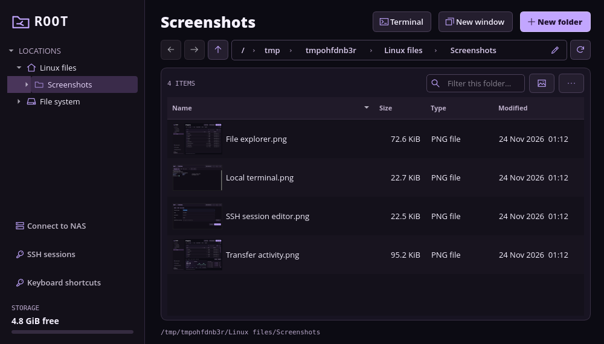
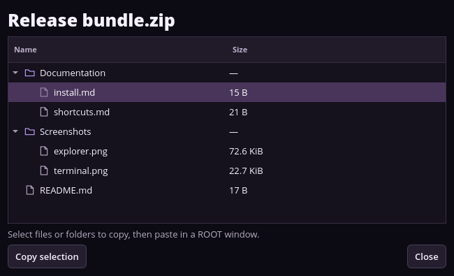
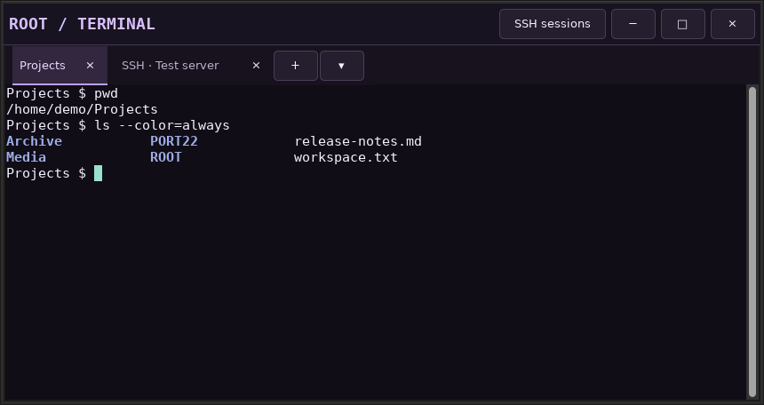
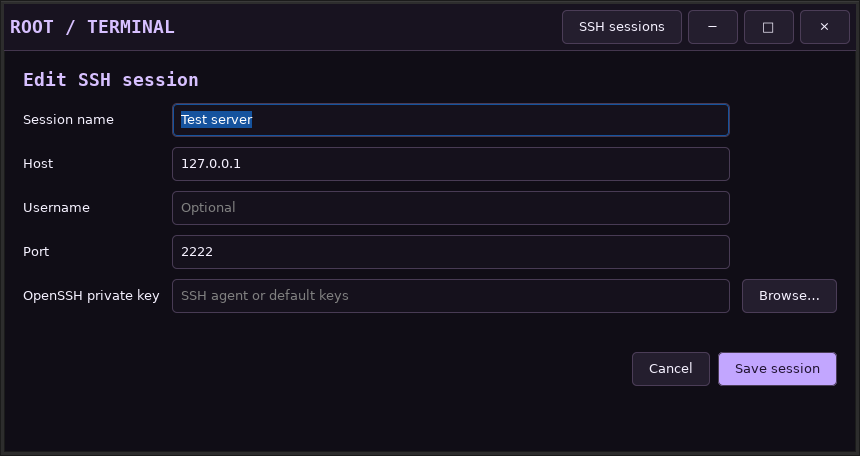
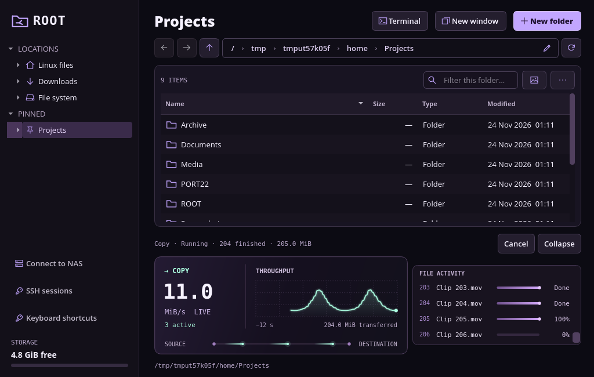

# ROOT

ROOT is a native file explorer for the Linux environment on a Chromebook. Independent windows share a clipboard and a transfer queue. Its dark violet interface, mint throughput trace and four-row scrolling activity view come from [PORT22](https://github.com/smartdevuk/PORT22).

**[Download ROOT 1.2.0 for Chromebook / Debian](https://github.com/smartdevuk/ROOT/raw/refs/heads/main/packages/root-explorer_1.2.0_all.deb)** · [Install and pin ROOT](#install-on-a-chromebook) · [Archive browsing](#images-and-archives)

## Install on a Chromebook

1. If you already use PORT22, your Linux environment is ready. Otherwise turn on **Linux development environment** in ChromeOS Settings.
2. Download the **Debian installer** using the link above. In the ChromeOS Files app, right-click it and select **Install with Linux** if offered.
3. Alternatively, move the installer to the top level of **Linux files**, open Terminal and run the commands below.
4. If you are upgrading, let transfers finish and close any running ROOT file and terminal windows. Press the **Launcher** key (Search), type **ROOT**, and click the app to open it.
5. While ROOT is open, right-click its icon on the shelf at the bottom of the screen (or tap it with two fingers) and choose **Pin** or **Pin to shelf**. Click the pinned icon whenever you want to open ROOT.

~~~sh
sudo apt update
sudo apt install ~/root-explorer_1.2.0_all.deb
~~~

The Debian package uses the system Python, Qt 5, GVfs SMB, GTK 3, VTE and OpenSSH. Its package name and terminal command are both **root-explorer**. The code is architecture-independent and targets Debian 12 and 13. ROOT runs as your normal Linux user.

## Chromebook folders

The sidebar starts with Linux files. To browse ChromeOS Downloads, right-click **Downloads** in ChromeOS Files and choose **Share with Linux**. Refresh ROOT. It detects the shared locations under either /mnt/chromeos or /mnt/shared. The same procedure works for other locations ChromeOS allows you to share. Right-click a folder in ROOT to pin it to the sidebar.

## Browse your NAS

Press **Ctrl+L**, enter a Windows-style location such as `\\fileserver\Shared`, and press Enter. ROOT also accepts **smb://fileserver/Shared**. A sign-in window appears when the server requests credentials. Enter the NAS username and password, or select guest if your share permits it. ROOT keeps passwords out of its settings and path history.

Click any folder name in the address bar to jump directly to it. If the path is too long, **…** contains earlier folders. Click the pencil or press **Ctrl+L** to edit the full path. Expand the arrows in the left sidebar to browse one level at a time. Drag the sidebar divider to make long names easier to read.

The address bar puts matching recent folders first. It also suggests folders from the current directory or an accessible share. Use the arrow keys to select a suggestion, **Tab** to complete and keep typing, or **Enter** to open it. Start with `\\fileserver` to list shares if the NAS permits share browsing. When it restricts enumeration, enter the complete share path once. If the name works on Windows but fails in ROOT, choose **Connection settings** in the error banner or **Connect to NAS** in the sidebar. Keep the share address as `\\fileserver\Shared` and enter the NAS’s LAN address in the optional IP field. ROOT can suggest an IP when Linux resolves the local hostname. Verify it against the NAS, router, or the first line of `ping -4 fileserver` on Windows. Once the share opens, ROOT remembers the mapping for that server and keeps the friendly name in breadcrumbs, history and autocomplete. Revisit the same settings if the NAS address changes. UNC paths use SMB. If you already mounted an NFS export in Linux, browse its Linux mount path.

The bottom-left meter follows the current folder and shows free space on its volume. Hover over the bar for used, free and total capacity. Filesystems that omit capacity information display the available figures.

## Everyday file operations

- **Two windows.** Ctrl+N opens another window at the current location. Right-click a folder and choose **Open folder in new window** to open that folder directly. Each window maintains its own back and forward history.
- **Copy and move.** Select one or more entries with Ctrl-click or Shift-click. Use Ctrl+C or Ctrl+X in the source window and Ctrl+V in the destination. Dragging copies by default, and holding Shift while dropping in ROOT moves. A drop on a folder targets that folder.
- **Inline rename.** Select one entry and press Ctrl+Enter or F2. Type directly over the selected part of the name. ROOT selects `holiday.photo` in `holiday.photo.jpg`, and the whole name for folders and extensionless files. Press Enter to save or Escape to cancel.
- **Names and conflicts.** When a destination name exists, ROOT keeps both items and adds a suffix such as “(copy)” to the incoming name. A folder collision creates a distinct folder tree. Hidden files and empty folders are included. Local symbolic links are copied as links where supported.
- **Properties.** Right-click a folder and choose **Properties**, or press Alt+Enter. The calculation runs in the background. The report shows logical bytes, file and folder counts and the size and percentage for every immediate child, including its descendants. If the filesystem exposes allocation sizes, ROOT also reports space allocated to file data, counting local hard-linked data once. Inaccessible locations are flagged. Links inside a folder are never followed during the count. The folder options menu opens Properties for the current location.
- **Sort and filter.** Click a column header to sort, or press Ctrl+F to filter the current listing by name. Folders stay grouped. Space previews common images and the beginning of a text file. Enter opens a file in its associated app.
- **Trash.** Delete asks to move the selection to the desktop Trash. If a filesystem or NAS does not offer Trash, ROOT reports that and leaves the entry in place.

## Images and archives

Click the picture button beside the folder filter, or use **Folder options → Show image thumbnails**. Photos appear beside their filenames in a taller list. ROOT remembers the setting across windows and restarts. Visible images load in the background. Supported formats depend on the installed Qt image readers. Very large or unreadable images keep their file icon.

Double-click a ZIP, 7z, TAR or supported RAR archive to browse its folders. Ctrl-click entries to select files or directories, press **Ctrl+C**, then **Ctrl+V** in any ROOT destination window. Right-click an archive in the explorer for **Extract to filename/** or **Extract all here**. For example, the first choice puts the contents of `backup.tar.gz` in `backup/`. ROOT handles common compressed TAR variants and individual gzip, bzip2, xz and zstd streams.

Archive browsing is read-only. Extraction streams regular files, preserves empty folders and keeps both names when the destination already exists. The transfer panel shows progress and cancellation. ROOT skips archive links, special entries and paths outside the archive. Encrypted archives that need a password and some RAR variants require a separate archive tool.

## Terminal and SSH

Click **Terminal** in a file window to open your usual Linux shell in the folder on screen. Further clicks open another tab in the same terminal window. Click **+** beside the last tab or **Ctrl+Shift+T** to start a local shell in the active local tab’s working directory, including after you use `cd`. Local tabs run inside the Chromebook’s Linux environment. A mounted SMB folder also works when GVfs exposes it as a local path. If it has no local path, ROOT explains this in the file window. A shell running on the NAS itself uses a separate SSH connection and starts in the directory configured by that server.

Use **▾ → New window** or **Ctrl+Shift+N** for a separate terminal window. For several local maintenance commands, choose **▾ → Administrator tab**. This starts `sudo -H -s` using your existing Linux sudo permissions and prompts if required. Commands in this labelled tab run as root until you type `exit` or close it. Open ordinary tabs with **+**.

Choose **SSH sessions** from the sidebar or terminal window. Click **New session**, enter a name and host, and optionally choose a username, port or OpenSSH private key. Save it and click **Connect**, or double-click a saved session. You can edit and remove saved sessions, open several servers at once and reconnect an exited SSH tab. OpenSSH reads your Linux SSH config and agent. Host-key verification, passwords and key passphrases use the terminal prompt. ROOT stores the destination and chosen key path in your Linux account. The terminal works with interactive editors, arrow keys and Ctrl+C.

| Terminal shortcut | Action |
| --- | --- |
| Ctrl+Shift+T / Ctrl+Shift+W | Open local tab / close tab |
| Ctrl+Shift+N | New terminal window |
| Ctrl+PageUp / Ctrl+PageDown | Previous / next tab |
| Ctrl+Shift+C / Ctrl+Shift+V | Copy selection / paste |

## Copy and move progress

Pasting or dropping files shows a compact progress panel under the file listing. ROOT starts copying files as it discovers them, with up to three file copies in flight. The graph shows actual transferred bytes per second over the most recent 12 seconds. The route markers advance with bytes transferred. The four activity rows scroll through the most recent 256 files. Keep browsing during the transfer, or click **Collapse** to fold the graph away. When the job finishes, click **Details** or **Dismiss**. Earlier jobs are available under the folder options menu, **Copy and move history**.

Moves on the same volume normally finish as a rename and can show zero transferred bytes. For cross-volume moves, ROOT copies a file to a temporary destination, checks its byte count and source metadata, publishes the file, then removes its source. Cancellation stops the active job and preserves finished work. A partially moved tree can therefore have files in both locations. Removing an entry from transfer history leaves its files in place. Transfer history and recent folders survive a restart. In-progress jobs run while ROOT is open and do not resume after a system crash.

The screenshots show the native app with temporary sample files. The transfer capture used a paced local copy so the live graph and file lanes could be seen.

## Shortcuts

| Shortcut | Action |
| --- | --- |
| Ctrl+N | New window at the current location |
| Ctrl+Shift+Enter | Open the selected folder in a new window |
| Ctrl+Enter or F2 | Rename selected entry |
| Ctrl+L or Alt+D | Select the address bar |
| Tab in the address bar | Complete a folder path |
| Alt+Left / Alt+Right | Back / forward |
| Alt+Up | Parent folder |
| Ctrl+X / Ctrl+C / Ctrl+V | Cut / copy / paste |
| Ctrl+Shift+N | New folder |
| Alt+Enter | Properties |
| Space | Preview |
| Ctrl+. | Toggle hidden files |
| Ctrl+F | Filter this folder |
| Ctrl+R or F5 | Refresh |
| Delete or Alt+Backspace | Move selection to Trash |
| Ctrl+W | Close this window |

## Build and run from source

~~~sh
sudo apt install python3-pyqt5 python3-gi gir1.2-glib-2.0 gvfs-backends gvfs-fuse xdg-utils gir1.2-gtk-3.0 gir1.2-vte-2.91 openssh-client python3-libarchive-c sudo dpkg-dev
/usr/bin/python3 root_explorer/main.py
./build.sh
sudo apt install ./dist/root-explorer_1.2.0_all.deb
~~~

To open a specific location from Terminal, run either command below.

~~~sh
root-explorer ~/Downloads
root-explorer '\\fileserver\Shared'
~~~

Run the local file-operation and offscreen desktop tests from the source directory.

~~~sh
QT_QPA_PLATFORM=offscreen /usr/bin/python3 -m unittest discover -s tests
~~~

To exercise the native terminal from a graphical Linux session, run the test on a separate session bus. It opens a temporary working directory, starts a shell, interrupts a running command and opens another tab from the file window.

~~~sh
dbus-run-session -- /usr/bin/python3 tests/terminal_integration.py
~~~

## Design references

- [Google’s Files guide](https://support.google.com/chromebook/answer/1700055?hl=en-GB) and [Chromebook shortcuts](https://support.google.com/chromebook/answer/183101?hl=en) document Ctrl+Enter for renaming, Ctrl+. for hidden files and Space for preview.
- [Microsoft’s File Explorer keyboard shortcuts](https://support.microsoft.com/en-gb/accessibility/windows/keyboard-shortcuts-in-windows) informed navigation, address-bar focus, new windows and Properties.
- [Linux setup on ChromeOS](https://developers.google.com/chromeos/app-development/develop/setup) explains folder sharing. Debian’s [GVfs backends](https://packages.debian.org/trixie/gvfs-backends) provide SMB and SMB share browsing.
- PORT22’s native controls and transfer visualisations are adapted under the included MIT licence.

For the optional live SMB integration test, pass a writable test share. ROOT will prompt for the NAS credentials. The test creates a uniquely named folder for its fixtures and removes that folder on completion.

~~~sh
/usr/bin/python3 tests/smb_integration.py '\\fileserver\Shared'
~~~
